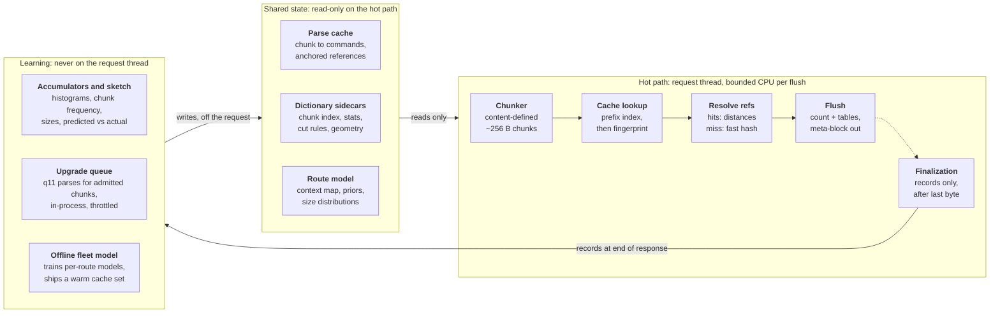

# Learned Brotli Encoder for Dynamic HTTP Response Compression

Oct 21, 2026 · Patrick Meenan · Source: [design doc](https://claude.ai/artifact/7MMJZCAHFqqYr2upeYTwAX)

## Summary

A brotli-format encoder for HTTP servers and CDNs that produces q11-quality output at close to q1 cost by remembering decisions across responses instead of rediscovering them on every stream. Web compression today is stateless per request: every response re-runs match finding, parse decisions and entropy modeling from scratch, and most origins settle for brotli q1 to save CPU. The decoder only requires a valid stream, so every one of those decisions can be cached, pre-trained or shipped alongside a dictionary. Three mechanisms carry the design: a content-addressed parse cache that stores how recurring template chunks were encoded, a pre-trained per-route entropy model that replaces q11's histogram clustering, and a streaming meta-block layout that removes per-flush header overhead for latency-critical documents. Dynamic HTML and JSON are the primary target; producing Compression Dictionary Transport (CDT) variants of static assets is the secondary target, built on the same chunk index.

Expected outcome: most of the q1-to-q11 size gap (typically 15 to 25% on HTML) recovered at a small multiple of q1 CPU on template-heavy sites, with the output a standard brotli stream any current browser decodes.

## Background and problem statement

Content-encoding on the web is limited to gzip, brotli and zstd, and in practice to the reference libraries or ports of them. Each library exposes a quality level that trades CPU for size, and each stream is compressed independently of every other stream the server has produced. The only cross-request state the ecosystem supports is an explicit shared dictionary via Compression Dictionary Transport (RFC 9842), which gives the decoder bytes to reference but leaves the encoder just as stateless.

For a server dynamically compressing HTML for one site, this wastes work. Responses from the same route share most of their bytes with every previous response from that route. The encoder re-finds the same matches, re-chooses the same parse, and re-clusters the same literal distributions on every request.

**Where the CPU goes.** At q1 the encoder hashes every position with one candidate and no lazy evaluation, makes no parse decisions, and still histograms and builds Huffman tables per meta-block. The entropy stage is a larger share than people expect because the match finder is so cheap. The q1-to-q11 size gap on HTML comes from four sources, all of which are deterministic functions of the input and so all memoizable:

1. Parse quality: lazy and optimal parsing versus greedy.
2. Context modeling and block splitting: several literal tables selected by the previous two bytes, chosen at q11 by expensive histogram clustering.
3. Window size.
4. Static dictionary matching with transforms, which the fast qualities skip entirely.

**What CDT covers and what it does not.** CDT lets a response reference bytes from a previous response the client already holds. It does not make the encoder cheaper; a dictionary-compressed q11 variant is a full q11 run with the dictionary attached. And it cannot help a server-only approach reach cross-request bytes without decoder cooperation. The two compose: this design reaches q11-class intra-document and dictionary matching at low cost, and CDT supplies the cross-request bytes.

**Operational context.** Latency-sensitive applications (search, commerce) flush on every application write, and CDNs flush on every read from the origin, so any design that depends on buffering or idle time is a non-starter for documents. Large fleets mean per-instance learning is slow and redundant, and output should be identical across instances for the same input.

## Goals and non-goals

**Goals**

- Produce standard brotli streams that any current browser decodes; no decoder changes, no new content-encoding.
- Recover most of the q1-to-q11 size gap on dynamic HTML and JSON at a per-byte cost close to q1, with bounded per-flush CPU on latency-critical responses.
- Work at the HTTP server or CDN layer with no application changes, and get better when the application supplies template hints.
- Handle both size-known and size-unknown responses, and both streaming-critical and completion-bound responses, with one encoder.
- Produce CDT dictionary variants of static assets cheaply enough to generate on the first request at full quality.
- Keep serving independent of learning: a cold cache and generic model must still produce valid, q1-or-better output, and all learning must be sheddable under load.
- Never let one user's content improve or leak into another user's response through shared state.

**Non-goals**

- Build-time compression of static assets. A site with a build pipeline should already produce q11 plain variants there; a site without one is not going to run offline training either.
- A zstd encoder. zstd is a fine format but lacks the static dictionary, context modeling and shared-window meta-blocks this design relies on (see Format choice). A later port is possible but out of scope.
- Beating q11 on size. q11 is close to the format's floor for a given input; a few percent may be available from site-level statistics on small responses, but the project's value is the CPU asymmetry, not the ceiling.
- Changes to the brotli or CDT specifications.

## Key insight: the format is the only constraint

A brotli quality level is purely an encoder knob. The decoder accepts any valid command stream with any valid tables, so an encoder that already knows the right matches, the right block boundaries and the right tables can emit q11 output at whatever cost it takes to look those answers up. Every expensive decision q11 makes is a deterministic function of the input bytes (and, for matches, of the preceding bytes), which makes each one memoizable:

| q11 work | What it depends on | How this design gets it cheaply |
| --- | --- | --- |
| Match finding and optimal parse | The chunk and its preceding content | Parse cache keyed by chunk fingerprint; references anchored to chunks, not absolute distances |
| Static and shared dictionary search with transforms | The chunk only | Cached with the parse; dictionary refs are context-independent and cache perfectly |
| Context map and block splitting | Site and route statistics | Pre-trained per-route model, emitted directly |
| Huffman table construction | The meta-block's symbol counts | Counting pass plus prior-smoothed table build at flush (microseconds) |

Two consequences shape everything else. First, the hot path only needs to read shared state; computing that state can happen off the request entirely. Second, because the window is shared across a whole brotli stream, cached commands from different chunks can be stitched into one meta-block and reference each other freely, so the unit of reuse can be a few hundred bytes without paying per-unit header overhead.

## Format choice: brotli

Brotli is the target format because it has the higher ceiling on exactly the content this project serves, and because most of the design's mechanisms only exist in brotli's format. Browsers support both brotli and zstd, so the choice is free from a client standpoint.

| Property | Brotli | zstd | Why it matters here |
| --- | --- | --- | --- |
| Built-in static dictionary (~122 KB, 121 transforms) | Yes | No | Large gain on HTML, JS, CSS; fast levels skip it, the parse cache restores it for free |
| Literal context modeling (64 contexts, context map, block types) | Yes | One literal table per stream | The largest single piece of the q1-to-q11 gap on HTML |
| Shared window across meta-blocks | Yes | Blocks within a frame | Lets cached chunk commands reference each other and dynamic content in one stream |
| Predefined zero-cost tables | No | Yes | zstd is cheaper on tiny streams; brotli needs the small-block policy in Streaming |
| Repeat previous block's tables | No | Yes | Brotli re-declares tables per meta-block; answered by the one-meta-block streaming layout |
| External sequence / custom match-finder API | No | Yes (`ZSTD_compressSequences`, sequence producer) | zstd would be easier to prototype on; brotli requires a forked encoder |

A zstd prototype was considered and rejected: it would measure a format that cannot express the dictionary and context-modeling gains, so its numbers would not transfer. The forked-brotli path has a tractable first milestone, since the encoder's command and meta-block writer is separable from its hashers: feed brotli's entropy coder a command list produced elsewhere, and build everything else on that primitive.

Brotli details relied on throughout:

- A stream is one header (window bits) followed by meta-blocks; each meta-block declares its own block types, context maps and prefix codes, and carries its uncompressed length (MLEN) in its header.
- Copies are backward distances into a window shared by all meta-blocks; static-dictionary words are distances beyond `max_distance`, which is `min(position, window - 16)` and so position-dependent early in the stream.
- A CDT dictionary acts as bytes preceding the stream, so dictionary copies are ordinary backward references.
- Uncompressed meta-blocks cost about 3 bytes of header and their bytes still enter the window.
- The encoder already ships a compile-time hash index of the static dictionary and prepares shared dictionaries once per dictionary; what it never caches is which positions in your content hit them.

## Architecture overview

*The hot path reads shared state; learning writes it off the request.*

Bytes land in the ring buffer (the window), the chunker cuts content-defined boundaries, each chunk is looked up by prefix and then fingerprint, references are resolved to distances (misses run the fast hasher), and each flush does one counting pass and emits a meta-block. Finalization runs after the last byte and only records. The hot path never writes shared state; the upgrade queue and the offline model do, and the offline model carries most of the gain because it is fleet-wide and ships a warm cache.

## Parse cache

The parse cache maps a content-addressed chunk of input to the command sequence that encoded it last time, so recurring template content is stitched into the stream without any match search. It replaces the earlier "precompressed fragment" idea, which was rejected because reusable fragments are a few hundred bytes (per CDT experience) and a per-fragment meta-block header is the same size.

**Chunking.** Content-defined chunking with a rolling hash, about 256-byte target at the fine level, with min/max bounds so long repeated runs still produce boundaries. Boundaries depend only on content, so streaming and flush points do not move them; a changed dynamic value only perturbs its own chunk. The hash parameters and bounds are a deployment-wide constant shared by the cache and every dictionary sidecar; changing them is a versioned migration. A multi-resolution index (recording each boundary's level, so coarse chunks are unions of fine ones) serves the static-asset case from the same pass.

**Cache entry.** Chunk fingerprint plus a command list: literal runs with block-type tags, and copies stored as references, not absolute distances:

- Chunk-anchored: (target chunk id, offset, length). The stitcher knows every emitted chunk's output position, so if the target chunk is present earlier in this response the distance resolves exactly with no search.
- Dictionary-anchored: (dictionary id, offset, length) for static-dictionary words (with transform) and CDT dictionary bytes. These are context-independent and always valid.
- Predicted-distance: the distance observed last time, verified at emit by `memcmp` at that distance and a small neighborhood (about plus or minus 64 bytes). Covers repeated structures whose stride shifts by a few bytes of dynamic data.

Unresolvable references degrade to a local search over the gap or to literals. Entries are roughly 20 to 40% of the chunk's size; a site with tens of MB of distinct template bytes is a cache of a few MB.

**Lookup.** A prefix index keyed on the first ~32 bytes after a boundary, verified incrementally as bytes arrive, so a flush that lands mid-chunk still matches its verified prefix and continues into the next flush. A full-chunk fingerprint confirms whole-chunk hits.

**Slots.** A chunk containing a dynamic value never repeats, so with content-defined boundaries alone the template bytes around every slot would never be cached. Two mechanisms recover them: on a prefix hit, extend by `memcmp` to the divergence point, emit the common prefix as a copy, the value as literals, and re-sync the suffix with a local search near the cached neighbor; then, once the same divergence point has been seen N times, store a cut rule ("at a boundary whose prefix hashes to X, also cut at offset Y") so prefix and suffix become admissible chunks of their own. Template hints from the application produce the same cuts directly.

**Misses** run a q1-class hasher over the chunk with predicted-distance hints from neighboring hits as first candidates. The chunk is sampled for the learner; the q11-quality parse is computed off the request and inserted so the next request hits. Cached regions are indexed sparsely for the fast hasher rather than hashing every byte.

**Admission** is gated: a chunk enters the shared cache only after being seen across N distinct sessions (see Security and privacy). Eviction is size-capped LRU; content addressing means a deploy's old chunks age out on their own.

## Entropy and modeling state

The expensive modeling decisions are pre-trained per route and loaded at runtime; only the cheap table build happens per meta-block. q11 spends its entropy effort clustering histograms to discover that markup, visible text, URLs and digits want separate literal tables. A server that has seen thousands of responses from a route already knows that, and the decoder reads whatever context map and tables the header declares without caring how they were chosen.

**Pre-trained per route (the model):**

- The literal context map: which of the 64 previous-two-byte contexts share a table, and how many literal tables to declare (typically 3 to 4 for HTML).
- Block-type policy: which content classes (markup, text, base64, JSON-in-script, inline CSS/SVG) get their own block type, driven by hints or a trivial scanner rather than a splitter.
- Prior histograms for literals per context, commands and distances.
- A ladder of table sets at different description budgets (about 10, 30, 80 and 300 bytes) for the small-meta-block fallback.
- Size and flush-size distributions, used by the streaming layout.

**Built at flush, per meta-block:** one counting pass over the meta-block's commands with the context map applied, then tables from the real counts smoothed with the prior. Building a 256-symbol Huffman code is microseconds and was never the expensive part. For a tiny meta-block the prior dominates; for a large one the counts dominate; the emitted table is never wrong for the response. Before emitting, the prior is pruned to symbols actually present, since brotli's table description cost grows with the number of nonzero code lengths.

**Size policy.** The response size is usually unknown up front, but every entropy decision is made at flush time when the meta-block's content is known, so no up-front size is needed. Below about 2 KB of meta-block, collapse to one literal table and no context map, because the map and extra tables cost more to describe than they save. Content-Length, when present, settles the policy before the first flush.

**Per-site statistics can beat per-document clustering** on small responses, where per-document histograms are noisy; this is a secondary gain, a few percent at most.

The site's static dictionary usage is also part of the model in the sense that the parse cache records which chunks hit it; the dictionary itself needs no training.

## Streaming and flush handling

Frequent flushes cost nothing on the match side, because the window is shared across meta-blocks, so the parse cache and dictionary matching are unaffected. The whole cost is per-meta-block entropy headers (roughly 0.5 to 1 KB for a full q11-style set, tens of bytes for sparse tables) plus a byte or two of alignment per flush. The primary design removes the header cost entirely; the fallback minimizes it.

### One meta-block per response (primary)

The decoder consumes the bit stream incrementally and (to be verified in the brotli decoder source) force-flushes decoded output when it runs out of input mid-meta-block. If so, the encoder emits the meta-block header once at the first flush, with the full pre-trained table set and context map, then streams commands into that one meta-block for the whole response, sending complete bytes at every flush. Literal tables switch via block-switch commands at a few bits each. Per-flush overhead is zero bytes.

- **MLEN commitment.** The header carries the uncompressed length up front. Commit to a per-route estimate (about the 90th percentile of observed sizes). Overflow starts a new meta-block and costs one header. Shortfall is padded to the committed length with a single copy command (distance 1, long length, about 5 bytes on the wire) of trailing whitespace, which HTML, JSON, CSS and JS all tolerate after their content. Always set ISLAST=0 and close with the 2-bit empty last meta-block.
- **Byte alignment at flush.** Only whole bytes can be sent, so the final command of a flush may straddle a byte boundary and wait in the decoder until the next write. The encoder re-parses the last few bytes of the flush among about ten alternatives (shorter copy plus literals, split copy, regrouped literals), each landing on a different residue mod 8, and picks one that ends on the boundary; this succeeds roughly three times in four. Otherwise it makes the straddling command a short literal insert so at most a byte or two is delayed, never a long copy.
- **Small first flush.** Sites that send a few hundred bytes of `<head>` with preload hints first should not wait behind a 1 KB table header. If the first flush is under about 1 KB, emit it as its own small meta-block (uncompressed or sparse tables) and open the committed meta-block at the second flush.

### Per-flush meta-blocks (fallback)

- Under about 100 bytes: an uncompressed meta-block (about 3 bytes of header; bytes still enter the window).
- Quantized, cheap-to-describe tables from the model's ladder, chosen by meta-block size with the cost estimate: description bytes plus counts dotted with code lengths.
- Tables learned per flush index: flush k of route R looks alike across requests because flush points are template-driven, so its tables can be precomputed.
- Parse-cache output is mostly long copies, so a 2 KB meta-block carries a dozen commands and few distinct distances; those fit brotli's simple prefix codes (1 to 4 symbols) and the literal table becomes the only real cost.
- No context map below a couple of KB.

### Zero-latency coalescing

Never wait for idle, but never flush twice in the same instant: application write loops issue several writes within microseconds, and a CDN's `read()` from the origin returns TCP-burst-sized pieces. Coalescing writes issued within one event-loop turn (as nginx already does) adds no measurable latency and removes most sub-KB meta-blocks.

## Response modes

The mode is a two-axis decision, not two fixed modes, because the axes come from different signals: whether the size is known up front, and whether partial delivery matters.

*Two signals pick the mode: size known, and whether partial delivery matters.*

|  | Completion-bound | Streaming-critical |
| --- | --- | --- |
| **Size known** | **Static assets** — q11 at build; CDT variants on demand. JS, CSS bundles; fonts, SVG, cacheable public HTML | **Buffered document** — rare: real tables, stream bytes out early. Framework-buffered HTML with Content-Length |
| **Size unknown** | **Dynamic API responses** — buffer to a cap, compress once; past cap, stream. fetch and XHR JSON; generated script, style | **Streaming documents (primary)** — one meta-block, committed MLEN. document, iframe; event-stream, ndjson, chunked text |

The bottom-right cell is the project's primary target and the only one that needs the streaming layout; the other three compress once with real tables.

**Signals for "streaming matters":** Sec-Fetch-Dest `document` and `iframe` are critical-path for every byte. `script` and `style` are completion-bound (CSS blocks render until complete; classic scripts execute on completion). `empty` (fetch/XHR) is completion-bound unless the content type is `text/event-stream`, `application/x-ndjson` or another chunked-text pattern, which are streaming by definition. The RFC 9218 `Priority` request header's `incremental` bit states the same thing directly where sent. Non-browser clients fall back to content type plus Accept.

**Signals for "size known":** Content-Length on the response, or an asset the server holds in full. A surprising share of dynamic HTML arrives from application frameworks already buffered with Content-Length set, which puts it in the size-known column while still streaming compressed bytes out.

**Cell notes.**

- Size known, completion-bound: the static-asset case; plain q11 is produced at build time (out of scope) and CDT variants by the dictionary path.
- Size unknown, streaming: the one-meta-block layout with committed MLEN, byte-aligned flushes and bounded per-flush CPU; misses use the fast hasher with a time cap.
- Size unknown, completion-bound: buffer to a cap (128 to 256 KB or a few milliseconds), then compress once with real MLEN and real histograms; past the cap, fall through to streaming mode for the remainder. These can run off the request thread with a slightly higher CPU budget.
- Cacheability cuts across: `Cache-Control: public` with a long max-age moves a response to the static column regardless of origin; `private` or `Set-Cookie` keeps it per-request and tightens shared-cache admission.

**What a mode controls.** One encoder, with the mode affecting exactly four things: when the table header is emitted, where MLEN comes from (actual or committed), whether flushes are byte-aligned eagerly, and which thread runs the work. Keeping it to those four makes mid-response mode changes safe, which the buffer-cap fallthrough needs.

## Content-aware optimizations and hints

The server and the application know things the compressor currently rediscovers byte by byte. Hints come from three places, each a separate interface.

**HTTP headers (always available at the server):**

| Signal | Decision it drives |
| --- | --- |
| Content-Type and charset | Model selection (HTML, JSON, CSS, SVG differ sharply); literal context mode; a separate model for non-UTF-8 encodings such as Shift-JIS or GBK |
| Request path / route | Per-route model and parse-cache namespace |
| Available-Dictionary / Use-As-Dictionary | Which prepared dictionary and sidecar to load; dictionary-relative references in the cache |
| Sec-Fetch-Dest, Priority (RFC 9218) | Streaming-matters axis (see Response modes) |
| Content-Length | Size-known axis; table policy settled before first flush |
| Cache-Control, Set-Cookie, Authorization | Cacheability; shared-cache admission tightening for private responses |

**Template hints (optional, from the application):** slot boundaries, so chunks align to slots; slot types (number, timestamp, URL, JSON, base64, free text) mapped to a literal table and a search policy; and secret slots (CSRF tokens, session-bound ids) marked literal-only, never indexed and never used as a match verification target. Secret slots make BREACH-style attacks structurally impossible for those spans rather than mitigated by padding.

**Runtime scanning (no hints needed):**

- Base64 and data URIs are not incompressible; they are exactly 25% compressible by literal coding (64 symbols, 6 bits). Give them their own literal table via a block-type switch, skip match search, and keep them out of the hash table and the main histograms so they do not dilute the text table. Alphabet-run detection finds them cheaply. A repeated inline asset is also a parse-cache hit.
- Embedded sublanguages (inline `<script>` JSON, `<style>`, inline SVG) each get a block type; boundaries come from a trivial tag scanner.
- High-entropy short tokens (content hashes in asset URLs, UUIDs): skip search, dedicated table, and watch for stability across a deploy.
- Whitespace runs and minification artifacts: trivially handled by the parse.

For JS and CSS specifically (relevant to the CDT path): inline `//# sourceMappingURL=data:` maps, base64-embedded WebAssembly, bundler-emitted `JSON.parse("...")` blobs, and `.map` files whose `mappings` field is VLQ text, all want the base64/dedicated-table treatment, while license banners and polyfill blocks repeated across bundles are cross-file chunk hits.

## Learning architecture

One rule governs the split: the hot path only reads shared state, the post-stream pass only records, and anything that computes new shared state happens off the request. The compressor's cost per byte is then fixed regardless of what learning is doing, and learning can be shed under load without changing output.

| Tier | Runs | Does | Budget |
| --- | --- | --- | --- |
| Inline | On the request thread, during compression | Cache and model lookups; hit/miss counts; a frequency-sketch bump per chunk fingerprint (no content stored); per-response throttling of lookups that are not paying off | Zero beyond the compression itself |
| Post-stream finalization | On the request thread, after the last byte, before the response context is released | Records fingerprint sequence per route; copies raw bytes of chunks that just crossed the admission threshold into the upgrade queue; merges per-context histograms into thread-local route accumulators; records size, flush sizes, predicted-vs-actual MLEN and table cost; samples whole responses (about 1%) for the offline trainer, skipping private responses and secret slots | Tens of microseconds; first thing shed under load |
| Async upgrade queue | Background thread in the server process, throttled | Computes q11-quality parses for admitted chunks (optimal parse under the route cost model, full static and shared dictionary search with transforms, chunk-anchored refs); inserts into the parse cache; eviction; periodic table rebuilds from accumulators | A few percent of a core |
| Offline fleet model | Out of process, fleet-wide | Trains per-route models from samples: context maps, block policies, table ladders, size distributions, admission thresholds; produces a warm cache set (most frequent chunks with parses); aligns with deploys; audits admitted content | Unbounded |

**Why the fleet model carries most of the gain.** A thousand instances learning on their own converge slowly, duplicate work, and make output depend on which instance served the request. A versioned model blob with a warm cache set means a fresh instance serves q11-quality output on its first request and every instance produces identical output for identical input. The in-process upgrade queue covers the long tail the sampler did not see.

**Deploy alignment.** Templates change on release. Ideally the model is trained against the release before it ships by rendering representative pages in the build; failing that, a hit-rate drop on a route triggers a faster relearn cycle. Content addressing means stale chunks simply stop hitting and age out.

**Finalization is cheap because nothing is copied.** At end-of-response the ring buffer still holds the raw bytes, the chunker has the boundaries and fingerprints, the command stream is resolved, and the last flush's histograms exist. Only admitted-chunk bytes and sampled responses leave the request context.

**Graceful degradation.** With a cold cache and the generic model the encoder is a slightly-better-than-q1 brotli encoder; with a warm cache and a tuned model it is a q11 encoder at q1 cost. Every state between is a monotonic improvement, and finalization, the upgrade queue and model updates can each be turned off without affecting validity.

## Dictionaries and CDT

A dictionary is a region of the window that exists before byte zero, so everything the parse cache does with chunk-anchored references works against dictionary chunks too. CDT support is a milestone on the same codebase, not a separate system.

### Static asset variants

The plain q11 variant is produced at build time (out of scope). Dictionary variants cannot be: which `Available-Dictionary` a client sends depends on what it has cached, so (asset, dictionary) pairs are discovered from traffic and produced on demand. With the reference encoder each pair is a full q11 run with the prepared dictionary attached, seconds of CPU for a multi-MB bundle, so CDNs either eat the first-hit latency or downgrade quality. Three reused pieces make a variant cheap enough to generate on the first request at full quality:

1. **Chunk dedup against the dictionary.** Chunk both once (the sidecar holds the dictionary's index). Runs of identical chunks become single long copies into the dictionary region; for v123 against v120 that resolves 90%+ of bytes with a handful of commands and no search.
2. **Localized search for changed chunks.** A changed chunk is usually its old self with a few bytes different. Its neighbors say where the old chunk sits in the dictionary, so the search is "look around here," a few comparisons at predicted offsets.
3. **Parse recovery from the build's `.br` file.** A modified decoder that emits commands instead of bytes recovers q11's intra-file parse, block splits and context maps at decode speed. Producing the variant is then: replace command spans covering dictionary-matched runs with dictionary copies (a straddling copy is split at the run edge; both halves stay valid), optionally try localized dictionary matches inside changed regions, keep everything else, and re-entropy-code. Intra-file copies remain valid because the output bytes are the same regardless of source. Cost is roughly decode plus chunk-hash plus entropy-code, hundreds of MB/s.

Variants are cached per (asset hash, dictionary hash). The chunk index doubles as a compressibility estimator: the fraction of an asset's chunks present in a candidate dictionary predicts the savings without compressing, which guides which prior versions to retain and which resources a `Use-As-Dictionary` match pattern should cover.

### Generated site dictionary for documents

The admitted-chunk set from the parse cache is exactly the material for a site dictionary served with `Use-As-Dictionary` for documents, which is the one place a server-only encoder cannot reach cross-request bytes. The learning system produces the dictionary CDT needs, CDT delivers it, and the parse cache stores dictionary-relative references so the streaming encoder gets those matches on the hot path. Because the server controls a generated dictionary's layout: place the most-referenced chunks nearest the end (cheapest distances), keep chunks that co-occur adjacent (predicted-distance search works), and its chunk set is literally the admission list, so cut rules are known at generation time. The admission gate is also the privacy boundary for dictionary contents.

### Dictionary sidecar (computed from the dictionary alone at storage time)

One flat memory-mappable file next to each retained dictionary, versioned by dictionary hash and chunker version, loaded with an `mmap` and a header check:

| Contents | Size | Purpose |
| --- | --- | --- |
| Multi-resolution chunk index: boundaries with levels, fingerprints, offsets | ~3% of dictionary | Whole-chunk copies with zero search; coarse-first for static, fine for documents |
| Prefix index (hash of first ~32 bytes per chunk) | Small | Match before a whole chunk is in hand; slot handling |
| Duplicate canonicalization (index only the occurrence nearest the end) | None | Cheapest distance for repeated content |
| Entropy statistics (64-context literal histograms, command and distance stats from a self-parse) | Small | Prior for responses of the same type |
| Region classification (base64, JSON-in-string, markup, text) | Small | Search policy for changed chunks next to a region; block-type hints |
| Window geometry (size; reachable response offset per window setting) | Trivial | lgwin and MLEN decisions without thought |
| Identity and policy (SHA-256, Use-As-Dictionary fields, version stamp) | Trivial | Matching and advertisement |
| Cut rules (generated dictionaries only) | Small | A hint-free chunker on a CDN reproduces the dictionary's boundaries exactly |
| Sparse position index (4-byte hash every 8 to 16 bytes), optional | 25 to 50% of dictionary | Search in changed regions with no localizing neighbor; stored for hot dictionaries, computed lazily otherwise |

A full per-position index like brotli's prepared dictionary is several times the dictionary's size and is not needed: the chunk index plus localized `memcmp` scans do most of the work. Traffic-dependent state (which variants exist, hit rates) is a cache keyed by dictionary, not part of the sidecar.

### Chunker resolution

Static-versus-previous-version wants coarse chunks (about 4 KB: diffs are sparse, copies long, index small). Documents want fine chunks (about 256 bytes: template fragments between slots are that size). One rolling hash with a mask gives both: record each boundary's trailing-zero level and coarse chunks are exact unions of fine ones. Static dedup then zooms: coarse matches first, fine chunks to narrow the diff region at the edges of a changed coarse chunk, then the hasher only on what remains.

### Constraints

- The dictionary plus the response must fit the client's maximum window; the caps differ between brotli and zstd paths in browsers and bound how large a pair this works for.
- A variant can only be produced while the full dictionary bytes are retained server-side, so retention of prior versions trades storage against `Available-Dictionary` hit rate.
- Parse recovery assumes the build's `.br` used a window compatible with the variant stream; otherwise copies beyond the smaller window are re-resolved via the chunk index.

## Security and privacy

Shared state across requests creates channels that stateless compression does not have, and the design treats the admission gate as the single boundary for all of them.

- **Cross-user cache leakage.** A shared parse cache leaks through timing: whether a chunk hits reveals whether some other user's response contained it. Chunks enter the shared cache, the generated dictionary and the offline samples only after being seen across N distinct sessions, so only template content is ever shared. Private responses (`Cache-Control: private`, `Set-Cookie`, `Authorization` on the request) tighten the gate further, and multi-tenant deployments partition caches per tenant.
- **BREACH-style attacks.** Compressing dynamic HTML containing secrets alongside attacker-influenced input is already a known risk. Secret slots from template hints are literal-only, never indexed and never used as match verification targets, which removes those spans from the attack surface entirely rather than padding around it. Without hints, high-entropy short-token detection applies the same policy heuristically.
- **Sampling.** Whole-response samples for the offline trainer skip private responses and strip secret slots. Admitted-chunk bytes are the only other content that leaves the request context.
- **Dictionary contents.** A generated site dictionary is served to every client, so it is built only from admitted chunks and audited offline for anything that looks per-user.
- **Determinism.** The fleet model makes output identical across instances for identical input, which also means a compressed response cannot be used to infer which instance or cache state served it.

## Decisions log

| Decision | Rationale |
| --- | --- |
| Target brotli, not zstd; forked encoder | Static dictionary, context modeling and shared-window meta-blocks are most of the gain and only exist in brotli. A zstd prototype would measure the wrong thing. |
| Dynamic responses first; CDT static variants second; build-time static compression out of scope | A site with a build should already produce q11 there; one without a build will not run training either. Dictionary variants cannot be built ahead because the pairs come from traffic. |
| Reject precompressed fragment concatenation | Reusable fragments are a few hundred bytes (CDT experience); per-fragment headers cost the same. Cache command sequences stitched into one meta-block instead. |
| Parse cache references are chunk-anchored, dictionary-anchored or predicted-distance, never absolute | Absolute distances break whenever preceding content changes; anchored references resolve exactly, predictions verify cheaply. |
| Pre-train modeling decisions; build tables per meta-block from real counts smoothed with a prior | Clustering is the expensive part; Huffman construction is microseconds. Size-unknown responses are handled because tables are chosen at flush. |
| One meta-block per response for streaming documents, with committed MLEN and padding | Removes per-flush header cost entirely for flush-on-every-write applications. Depends on decoder partial-output behavior (to verify). |
| Tiny first flush gets its own small meta-block | Preload-hint `<head>` flushes must not wait behind a 1 KB table header. |
| Two-axis mode selection; mode controls only four switches | Size-known and streaming-matters come from different signals; limiting what a mode touches makes mid-response mode changes safe. |
| Hot path reads, finalization records, background computes | Fixed per-byte cost; learning sheddable; output independent of learning state. |
| Offline fleet model with a warm cache set carries most of the gain | Per-instance learning is slow and redundant; a versioned blob gives cold-start quality and cross-instance determinism. |
| Admission gate (N distinct sessions) is the one privacy boundary | Same gate protects the cache, the generated dictionary and the samples. |
| Secret slots are literal-only and never indexed | Structural BREACH defense for the spans that matter. |
| Dictionary metadata lives in a mmap-able sidecar computed from the dictionary alone | Everything the hot path needs is a function of the dictionary bytes; the prepared-dictionary concept in brotli is right but in-memory, hasher-specific and large. |
| One chunker with multi-resolution levels, not two chunkers | Static wants ~4 KB, documents ~256 bytes; one rolling hash with recorded levels serves both and keeps every index mutually consistent. |
| Learned cut rules plus prefix extension for dynamic slots | Content-defined boundaries alone never admit the template bytes around a slot. |

## Open questions and verification list

**To confirm in decoder source (the one-meta-block layout depends on the first two):**

- [ ] The brotli decoder force-flushes decoded output when it runs out of input mid-meta-block, and Chromium's brotli source stream delivers that partial output to the parser rather than waiting for a meta-block boundary.
- [ ] Firefox and WebKit decoders behave the same way for partial meta-blocks.
- [ ] Current browser window caps for brotli and zstd with and without a CDT dictionary, which bound the asset-plus-dictionary pairs the static path can serve.
- [ ] Trailing-whitespace padding after `</html>` has no observable parser or `readyState` effect beyond the whitespace text node.

**To settle by measurement:**

- [ ] On a corpus of real responses from two or three templated sites: q1 vs q11 size and CPU, and the fraction of the gap each mechanism recovers (parse cache alone, model alone, both).
- [ ] Chunk-cache hit rate by route with and without cut rules, and with template hints.
- [ ] Actual header cost of a full q11-style table set vs the ladder entries, to calibrate the small-meta-block thresholds.
- [ ] Distribution of flush sizes on a flush-on-every-write server, before and after same-tick coalescing.
- [ ] Per-flush CPU on documents with the fast-hasher time cap, and p99 added latency.
- [ ] MLEN estimate accuracy per route (overflow and padding rates).
- [ ] Byte-alignment lottery success rate and the delayed-byte distribution when it fails.

**Design questions still open:**

- [ ] The right N for admission, and whether it should vary with response privacy signals.
- [ ] Cache and model namespace granularity: per route, per route-plus-content-type, or per template id when hints are available.
- [ ] How template hints are conveyed from the application to the server (a header, a trailer, a sidecar API) without putting hint bytes on the wire to the client.
- [ ] Whether the upgrade queue's q11 parse should use the route's current cost tables or a neutral cost model, given tables drift as the model retrains.
- [ ] Prior art: memoized LZ encoding specifically. Nothing well-known is in hand; worth a literature and patent search before publishing.

## Milestones and measurement plan

Each milestone produces a measurable number, and the first two decide whether the rest is worth building.

1. **Corpus and baseline.** Collect real responses from two or three templated sites (documents and JSON), with route labels. Measure q1 and q11 size and CPU. This is the yardstick for everything after.
2. **Command-list injection.** Fork brotli so its entropy coder and meta-block writer accept an externally produced command list. Validate by round-tripping q11's own parse. This primitive is what every later milestone hangs off.
3. **Offline parse cache.** Chunker, cache entries with anchored references, stitcher, q1 hasher for misses. Run the corpus twice; report hit rate and size on the second pass versus q1 and q11. Add cut rules and measure the hit-rate change.
4. **Route model.** Train context maps and priors offline; prior-smoothed tables at flush. Report the size gain with and without the parse cache, especially on small responses.
5. **Streaming layout.** One-meta-block mode with committed MLEN, alignment lottery and small-first-flush policy, after the decoder behavior is confirmed. Measure on a flush-on-every-write replay: per-flush CPU, delayed bytes, padding overhead.
6. **Server integration.** Mode selection from headers, same-tick coalescing, finalization pass and the upgrade queue inside a real server (nginx module or equivalent). Measure under load, including shedding.
7. **Fleet model and warm cache.** Versioned model blob; cold-start quality on a fresh instance; cross-instance determinism check.
8. **CDT static variants.** Dictionary sidecar, chunk dedup, localized search, parse recovery from `.br`. Measure variant generation time and size against a full q11-with-dictionary run.
9. **Generated site dictionary.** Build from admitted chunks, serve via `Use-As-Dictionary`, store dictionary-relative references in the cache. Measure document size with and without.

The first experiment, before any of this: on the corpus from milestone 1, compute how many bytes of each response are byte-identical at ~256-byte chunk granularity to an earlier response from the same route. That number is an upper bound on what the parse cache can resolve without search, and if it is low on the target sites the design should change before code is written.
