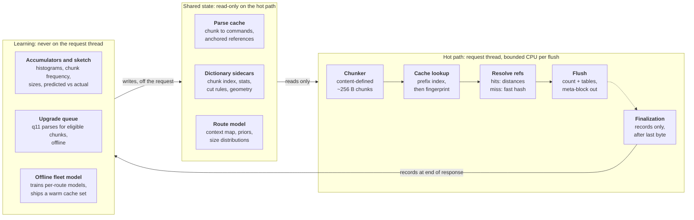

# Learned Brotli Encoder for Dynamic HTTP Response Compression

Oct 21, 2026 · Patrick Meenan · Originally drafted as a [design doc](https://claude.ai/artifact/7MMJZCAHFqqYr2upeYTwAX); this repository copy is authoritative (D-001).

Revised through D-012–D-018. Per-flush encoding is the initial streaming design; exact-length single-meta-block encoding is a parked experiment. The project remains pre-code.

## Summary

A brotli-format encoder for HTTP servers and CDNs that produces q11-quality output at close to q1 cost by remembering decisions across responses instead of rediscovering them on every stream. Web compression today is stateless per request: every response re-runs match finding, parse decisions and entropy modeling from scratch, and most origins settle for brotli q1 to save CPU. The decoder only requires a valid stream, so every one of those decisions can be cached, pre-trained or shipped alongside a dictionary. Three mechanisms carry the design: a content-addressed parse cache that stores how recurring template chunks were encoded, a pre-trained per-route entropy model that replaces q11's histogram clustering, and a streaming meta-block layout that reduces header cost while preserving prompt delivery for latency-critical documents. Dynamic HTML and JSON are the primary target; producing Compression Dictionary Transport (CDT) variants of static assets is the secondary target, built on the same chunk index.

Expected outcome: most of the q1-to-q11 size gap (typically 15 to 25% on HTML) recovered at a small multiple of q1 CPU on template-heavy sites, with the output a standard brotli stream any current browser decodes.

## Background and problem statement

Content-encoding on the web is limited to gzip, brotli and zstd, and in practice to the reference libraries or ports of them. Each library exposes a quality level that trades CPU for size, and each stream is compressed independently of every other stream the server has produced. The only cross-request state the ecosystem supports is an explicit shared dictionary via Compression Dictionary Transport (RFC 9842), which gives the decoder bytes to reference but leaves the encoder just as stateless.

For a server dynamically compressing HTML for one site, this wastes work. Responses from the same route share most of their bytes with every previous response from that route. The encoder re-finds the same matches, re-chooses the same parse, and re-clusters the same literal distributions on every request.

**Where the CPU goes.** At q1 the encoder hashes every position with one candidate and no lazy evaluation, makes no parse decisions, and still histograms and builds Huffman tables per meta-block. It also compresses each input fragment with a freshly cleared hash table, so it never matches across input calls or flushes, whatever the window (RE-002). The cheap streaming baseline is therefore q2-class, and the honest comparison is the whole reference quality curve, not q1 alone (D-016). The entropy stage is a larger share than people expect because the match finder is so cheap. The q1-to-q11 size gap on HTML comes from four sources, all of which are deterministic functions of the input and so all memoizable:

1. Parse quality: lazy and optimal parsing versus greedy.
2. Context modeling and block splitting: several literal tables selected by the previous two bytes, chosen at q11 by expensive histogram clustering.
3. Window size.
4. Static dictionary matching with transforms, which the fast qualities skip entirely.

**What CDT covers and what it does not.** CDT lets a response reference bytes from a previous response the client already holds. It does not make the encoder cheaper; a dictionary-compressed q11 variant is a full q11 run with the dictionary attached. And it cannot help a server-only approach reach cross-request bytes without decoder cooperation. The two compose: this design reaches q11-class intra-document and dictionary matching at low cost, and CDT supplies the cross-request bytes.

**Operational context.** Latency-sensitive applications (search, commerce) flush on every application write, and CDNs flush on every read from the origin, so any design that depends on buffering or idle time is a non-starter for documents. Large fleets mean per-instance learning is slow and redundant, and output should be identical across instances for the same bytes, logical flush positions, model and options (D-014).

## Goals and non-goals

**Goals**

- Produce ordinary RFC 7932 `br` responses and optional negotiated RFC 9841/9842 `dcb` variants, preserving the exact input bytes. No custom formats, client decoder changes or decoded-content padding.
- Recover most of the q1-to-q11 size gap on dynamic HTML and JSON at a per-byte cost close to q1, with bounded per-flush CPU on latency-critical responses.
- Work at the HTTP server or CDN layer with no application changes, and get better when the application supplies template hints.
- Handle both size-known and size-unknown responses, and both streaming-critical and completion-bound responses, with one encoder.
- Produce CDT dictionary variants of static assets cheaply enough to generate on the first request at full quality.
- Keep serving independent of learning: a cold or rejected model selects the q2-class reference encoder before encoding, under the same window and flush policy (D-016). Learning is sheddable without affecting validity; warm-model gains are measured.
- Train shared artifacts only from approved public sources and eligible spans; exclude private traffic from all learning paths. Literal-only secret slots are a mitigation, not a proof of compression-side-channel resistance.

**Non-goals**

- Build-time compression of static assets. A site with a build pipeline should already produce q11 plain variants there; a site without one is not going to run offline training either.
- A zstd encoder. zstd is a fine format but lacks the static dictionary, context modeling and shared-window meta-blocks this design relies on (see Format choice). A later port is possible but out of scope.
- Beating q11 on size. q11 is close to the format's floor for a given input; a few percent may be available from site-level statistics on small responses, but the project's value is the CPU asymmetry, not the ceiling.
- Changes to the brotli or CDT specifications.

## Key insight: the format is the only constraint

A brotli quality level is purely an encoder knob. The decoder accepts any valid command stream with any valid tables, so an encoder that already knows the right matches, the right block boundaries and the right tables can emit q11 output at whatever cost it takes to look those answers up. Every expensive decision q11 makes is a deterministic function of the input bytes (and, for matches, of the preceding bytes), which makes each one memoizable:

| q11 work | What it depends on | How this design gets it cheaply |
| --- | --- | --- |
| Match finding and optimal parse | The chunk and its preceding content | Parse cache keyed by chunk fingerprint; references anchored to chunks, not absolute distances |
| Static and shared dictionary search with transforms | The chunk only | Cached with the parse; dictionary refs are context-independent and cache perfectly |
| Context map and block splitting | Site and route statistics | Pre-trained per-route model, emitted directly |
| Huffman table construction | The meta-block's symbol counts | Counting pass plus prior-smoothed table build at flush (microseconds) |

Two consequences shape everything else. First, the hot path only needs to read shared state; computing that state can happen off the request entirely. Second, because the window is shared across a whole brotli stream, cached commands from different chunks can be stitched into one meta-block and reference each other freely, so the unit of reuse can be a few hundred bytes without paying per-unit header overhead.

## Format choice: brotli

Brotli is the target format because it has the higher ceiling on exactly the content this project serves, and because most of the design's mechanisms only exist in brotli's format. Browsers support both brotli and zstd, so the choice is free from a client standpoint.

| Property | Brotli | zstd | Why it matters here |
| --- | --- | --- | --- |
| Built-in static dictionary (~122 KB, 121 transforms) | Yes | No | Large gain on HTML, JS, CSS; fast levels skip it, the parse cache restores it for free |
| Literal context modeling (64 contexts, context map, block types) | Yes | One literal table per stream | The largest single piece of the q1-to-q11 gap on HTML |
| Shared window across meta-blocks | Yes | Blocks within a frame | Lets cached chunk commands reference each other and dynamic content in one stream |
| Predefined zero-cost tables | No | Yes | zstd is cheaper on tiny streams; brotli needs the small-block policy in Streaming |
| Repeat previous block's tables | No | Yes | Brotli re-declares tables per meta-block; minimize with sparse tables, then measure an exact-length single-block experiment |
| External sequence / custom match-finder API | No | Yes (`ZSTD_compressSequences`, sequence producer) | zstd would be easier to prototype on; brotli requires a forked encoder |

A zstd prototype was considered and rejected: it would measure a format that cannot express the dictionary and context-modeling gains, so its numbers would not transfer. The forked-brotli path has a tractable first milestone, since the encoder's command and meta-block writer is separable from its hashers: feed brotli's entropy coder a command list produced elsewhere, and build everything else on that primitive.

Brotli details relied on throughout:

- A stream is one header (window bits) followed by meta-blocks; each meta-block declares its own block types, context maps and prefix codes, and carries its uncompressed length (MLEN) in its header.
- Copies are backward distances into a window shared by all meta-blocks; static-dictionary words are distances beyond `max_distance`, which is `min(position, window - 16)` and so position-dependent early in the stream.
- A CDT dictionary is an additional Shared Brotli address region outside the rolling window, not ordinary response history. See Dictionaries and CDT for the saturated-window distance formulas (D-012).
- Uncompressed meta-blocks cost about 3 bytes of header and their bytes still enter the window.
- The encoder already ships a compile-time hash index of the static dictionary and prepares shared dictionaries once per dictionary; what it never caches is which positions in your content hit them.

## Architecture overview

*The hot path reads shared state; learning writes it off the request.*

Bytes land in the ring buffer (the window), the chunker cuts content-defined boundaries, each chunk is looked up by prefix and then fingerprint, references are resolved to distances (misses run the fast hasher), and each flush does one counting pass and emits a meta-block. Finalization runs after the last byte and only records. The hot path never writes learned shared state. The offline trainer builds versioned artifacts from eligible public data, and the Worker loads them read-only. Live finalization records bounded aggregate operational counters, not training content (D-013).

## Parse cache

The parse cache maps a content-addressed chunk of input to the command sequence that encoded it last time, so recurring template content is stitched into the stream without any match search. It replaces the earlier "precompressed fragment" idea, which was rejected because reusable fragments are a few hundred bytes (per CDT experience) and a per-fragment meta-block header is the same size.

**Chunking.** Content-defined chunking with a rolling hash, about 256-byte target at the fine level, with min/max bounds so long repeated runs still produce boundaries (optionally biasing fine-level boundary masks toward markup/JSON delimiters such as `>` and `"` once past `min_chunk`). Boundaries depend only on content, so streaming and flush points do not move them; a changed dynamic value only perturbs its own chunk. The hash parameters and bounds are a deployment-wide constant shared by the cache and every dictionary sidecar; changing them is a versioned migration. A multi-resolution index (recording each boundary's level, so coarse chunks are unions of fine ones) serves the static-asset case from the same pass.

**Cache entry.** Chunk fingerprint plus a command list: literal runs with block-type tags, and copies stored as logical references, not absolute distances or distance short codes:

- Chunk-anchored: (target chunk id, offset, length), strictly contained within `target_chunk` (`offset + length <= len(target_chunk)`). Cross-chunk matches found during training are split at target-chunk boundaries so a dynamic slot inserted between two template chunks never causes a copy to overrun into the wrong bytes; when the target chunks remain contiguous in the current response, the stitcher can coalesce the split copies back into one command. Because the stitcher knows every emitted chunk's output position, if the target chunk is present earlier and still within retained history, its distance resolves with no search.
- Dictionary-anchored: (dictionary id, offset, length) for static-dictionary words (with transform) and CDT dictionary bytes. The logical reference is independent of response position when its dictionary identity and slice/transform are valid; the stitcher converts it to a concrete wire distance (`max_distance + cdt_dict_size + 1 + word_id` for static dictionary, `max_distance + cdt_dict_size - offset` for CDT; dictionary size is zero for ordinary `br`) at the current output position.
- Predicted-distance: the distance observed last time, verified at emit by `memcmp` at that distance and a small neighborhood (about plus or minus 64 bytes). Covers repeated structures whose stride shifts by a few bytes of dynamic data.

Distance short codes (`0..15` against brotli's 4-entry last-distance ring buffer) and 2-byte literal context IDs (`p1`, `p2` from the output window) are resolved during the stitch/flush pass rather than stored in cache entries, since preceding chunks and distances vary across responses (D-017). Unresolvable references degrade to a local search over the gap or to literals.

**Emit-time verification.** Before writing any copy, the encoder compares the source bytes in retained history (or the negotiated dictionary slice) with the input bytes the copy covers; static-dictionary references are expanded with their transform and compared. A mismatch falls back to local search or literals. Cache entries, fingerprints and predictions are hints only, so a hash collision, stale entry or corrupt artifact can cost size but never output correctness. The cost is linear in referenced bytes, roughly a `memcmp` per copy (D-017). Entries are roughly 20 to 40% of the chunk's size; a site with tens of MB of distinct template bytes is a cache of a few MB.

**Lookup.** A prefix index keyed on the first ~32 bytes after a boundary, verified incrementally as bytes arrive, so a flush that lands mid-chunk still matches its verified prefix and continues into the next flush. A full-chunk fingerprint confirms whole-chunk hits.

**Slots.** A chunk containing a dynamic value never repeats, so with content-defined boundaries alone the template bytes around every slot would never be cached. Two mechanisms recover them: on a prefix hit, extend by `memcmp` to the divergence point, reuse the verified prefix's parse commands (copies still need a source in the current response or negotiated dictionary), emit the value as literals, and re-sync the suffix with a local search near the cached neighbor; then, once the same divergence point has been seen N times in eligible public training captures, store a frozen cut rule ("at a boundary whose prefix hashes to X, also cut at offset Y") so prefix and suffix become admissible chunks of their own. Template hints from the application produce the same cuts directly.

**Misses** run a q1-class hasher over the chunk with predicted-distance hints from neighboring hits as first candidates and deterministic limits on candidates/bytes compared (D-014). How exhaustively it searches is the route model's learned search policy, not a fixed quality level. The offline trainer may compute q11-quality parses of eligible public chunks for the next artifact version; live misses do not export samples or mutate the model. Cached regions are indexed sparsely for the fast hasher rather than hashing every byte.

**A long dictionary hit ends the search.** When a miss finds a verified match into a negotiated CDT dictionary of at least a minimum length (one fine chunk, or a configured floor such as 32 bytes), the encoder takes it, extends it by `memcmp` in both directions, and does not search the window for that span. The window search is the expensive part of a miss, and a long dictionary match leaves little for it to win. The price is distance cost: a dictionary distance lies beyond `max_distance`, so it costs roughly `log2(window)` more extra bits than a nearby window copy and rarely reuses the last-distance ring buffer, and a window match could have been longer. One check stays because it costs no search: a predicted-distance hint already in hand that covers the same span is verified first and preferred, since its distance is cheaper. Built-in static-dictionary words (4–24 bytes) are too short to end a search; they are taken only when no window match of at least the same length is found. Whether to take the shortcut, and its minimum length, is part of the learned search policy (per route and content type, trained on training slices only), with a fixed default when no model applies. Measure it before relying on it: the win depends on how often a window copy would have been shorter in distance or longer in length.

**Admission** requires an approved public source and eligible spans before any cache, model or sample derivation (D-013). Frequency across eligible captures can prioritize useful chunks, but cannot prove content public. The offline builder selects a size-capped warm set; Worker lookups never mutate LRU state. Artifact refreshes retire obsolete chunks.

## Entropy and modeling state

The expensive modeling decisions are pre-trained per route and loaded at runtime; only the cheap table build happens per meta-block. q11 spends its entropy effort clustering histograms to discover that markup, visible text, URLs and digits want separate literal tables. A server that has seen thousands of responses from a route already knows that, and the decoder reads whatever context map and tables the header declares without caring how they were chosen.

**Pre-trained per route (the model):**

- The literal context map: which of the 64 previous-two-byte contexts share a table, and how many literal tables to declare (typically 3 to 4 for HTML).
- Block-type policy: which content classes (markup, text, base64, JSON-in-script, inline CSS/SVG) get their own block type, driven by hints or a trivial scanner rather than a splitter.
- Prior histograms for literals per context, commands and distances.
- A ladder of table sets at different description budgets (about 10, 30, 80 and 300 bytes) for the small-meta-block fallback.
- Size and flush-size distributions, used by the streaming layout.
- Search policy, per route and content type and optionally per chunk class or slot type: how hard a miss looks for the longest match (candidates per position, chain depth, an early-exit "good enough" length, lazy matching on or off, whether to try static-dictionary words) and the dictionary-hit shortcut's minimum length, or off (see Parse cache, Misses). Each setting is chosen offline from its measured size/CPU trade-off on training slices and shipped as an artifact constant, so output stays deterministic (D-014); the runtime work caps still bound it. A route whose content rarely repeats can search little; one with long distant repeats can afford more.

**Built at flush, per meta-block:** the initial per-flush layout has all block commands available before its header; the parked experiment needs a different policy (D-012):

- **Known-block modes (buffered modes and per-flush meta-blocks):** one counting pass over the meta-block's commands with the context map applied, then tables from the real counts smoothed with the prior. Building a 256-symbol Huffman code is microseconds and was never the expensive part. For a tiny meta-block the prior dominates; for a large one the counts dominate; the emitted table is valid for the response, but its size benefit must be measured. Before emitting, the prior is pruned to symbols actually present, since brotli's table description cost grows with the number of nonzero code lengths.
- **Parked exact-length one-meta-block experiment:** the meta-block header is emitted at the start of the stream before later flushes arrive, using an exact, trusted uncompressed length. Brotli has no End-of-Block symbol to exit a committed `MLEN` early; no estimate or padding may substitute for that length. The emitted tables therefore come directly from the pre-trained priors without pruning, and must satisfy a **completeness invariant**: every literal table (or a reachable fallback block-type table) assigns a nonzero code length (`1..=15`) to all 256 byte values, and the command and distance tables cover a universal basis of insert lengths, copy lengths and all reachable response/dictionary distances so no later flush can encounter an unencodable symbol.

**Size policy.** Initial per-flush table decisions use the available block's actual counts, even when total response size is unknown. Below roughly 2 KB, try one literal table without a context map and compare its cost; calibrate this threshold by measurement. Unencoded `Content-Length` may inform policy, but does not supply future counts. Only the parked exact-length experiment commits a table set before future bytes arrive.

**Per-site statistics can beat per-document clustering** on small responses, where per-document histograms are noisy; this is a secondary gain, a few percent at most.

The site's static dictionary usage is also part of the model in the sense that the parse cache records which chunks hit it; the dictionary itself needs no training.

## Streaming and flush handling

The window survives meta-block boundaries, but flushes can still shorten matches
and change parses. Measure those effects as well as table descriptions and
alignment. The initial encoder completes meta-blocks at logical flushes with
actual lengths. It preserves every decoded byte and never waits for later input
to finish a requested flush (D-012).

### Per-flush meta-blocks (initial design)

- Count the available block's commands, build pruned prior-smoothed tables and
  emit its actual MLEN. Split oversized reads into bounded blocks. Empty flushes
  emit no data block; EOF finalizes the same brotli stream.
- Compare table-description plus symbol-bit cost against cheap table-ladder
  entries and uncompressed blocks. Tiny blocks may use uncompressed data;
  calibrate the roughly 100-byte and 2-KB thresholds rather than hard-code
  them as demonstrated optima.
- Close any final literal run at the actual meta-block boundary. Add empty
  metadata alignment when needed to deliver all flush output as complete bytes
  (RFC 7932 §11.2); include that overhead in comparisons.
- Small first flushes use the same bounded policy, so preload hints do not wait
  for a later write or a large table header.
- Train per-flush-index tables only when logical flush positions are available
  from a cooperating origin or synthetic replay. Transport read index is not
  a stable template signal.

### Exact-length single-meta-block experiment (parked)

After M5 establishes the per-flush baseline, experiment only when the exact
uncompressed length is known before the header. Complete unpruned tables must
encode every later symbol. Content-Length alone does not provide future
histograms; use frozen priors or buffer the bytes. Validate the length and
abort on truncation or surplus input once committed; never fill a shortfall
with decoded whitespace. Estimated-MLEN padding is rejected (D-012).

RFC 7932 commands encode insert/copy lengths before the literals, but this does
not require every input pause to finish a copy. The reference decoder can expose
partial literal output before receiving the copy distance (RE-001). Encoding
future command fields still requires knowing they will be valid: decoder
partial-output capability does not supply unknown future bytes or matches.

Any experiment must account for pending command fields, unmatched tails,
bit alignment and decoder/runtime buffering. Tail-copy splitting and alternate
parses may help some inputs; neither a universal 2–4-byte bound nor a claimed
lottery success rate has been established. Test long unmatched tails, secrets,
short/empty responses, arbitrary fragmentation and EOF at every command phase.
Chromium, Firefox, WebKit and the Worker edge need delivery measurements, not
just full-stream round trips. Promotion requires byte identity and the delivery
and resource targets already set for the per-flush baseline.

### Logical flushes and transport fragments

The core accepts an ordered byte stream plus explicit logical flush positions.
Splitting a feed into smaller buffers without changing those positions must
produce identical output. Search limits count candidates/bytes compared rather
than wall-clock time (D-014).

The Worker maps origin reads to logical flushes through a flush policy. The
initial policy flushes each nonempty read after processing bounded blocks;
M5 also measures coalescing reads that are already available and a minimum
byte count unless the source is idle. Every flush pays a full table
declaration, so with many small reads the policy can cost as much as the
q1→q11 gap. Those reads reflect transport fragmentation; they do not preserve
application writes. Never wait on a timer for more document bytes. For offline
measurement, flush schedules come from served streams: the decoded offsets of
encoder flush boundaries in captured responses (D-018). Replay records logical positions separately from transport fragments;
end-to-end tests use paced origin markers and client arrival times over HTTP/2
and HTTP/3, without requiring packet or read boundaries to survive.

## Response modes

Size availability and whether partial delivery matters are separate signals.
Neither content type nor cacheability proves that future input is already in
memory. The initial modes are:

| | Completion-bound | Streaming-critical |
| --- | --- | --- |
| **Size known** | Buffer only within the configured cap, then compress with actual counts; otherwise per-flush blocks | Per-flush blocks; trusted exact length may later enable the parked single-block experiment |
| **Size unknown** | Buffer to a byte cap, then compress once at EOF; if the cap is reached, flush accumulated bytes and continue per-flush | Per-flush blocks with actual MLEN; HTML, SSE and ndjson all preserve the original bytes |

`Sec-Fetch-Dest: document` or `iframe`, SSE/ndjson content types and explicit
origin policy select streaming. Script/style and ordinary fetch JSON are usually
completion-bound, but content type and request hints are fallible; operator
route policy can override them. Priority hints affect policy, not knowledge of
body length or application flush positions.

Only a trusted Content-Length on an unencoded upstream representation, or a body
already held in full, supplies an exact uncompressed length. A compressed origin
Content-Length must never become MLEN (D-017); it also does not prove the origin
buffered its entire response. Knowing length does not reveal histogram counts.
Cacheability controls output reuse separately and does not convert a live body
into an available buffer. Private responses never become training inputs.

Use deterministic byte caps for completion-bound buffering. A wrapper may
cancel for elapsed time, but clock-triggered mode changes are outside the
byte-determinism contract. Mode changes and cheap continuations happen at
completed meta-block boundaries; an open block cannot be abandoned and replaced
by a fresh stream. Worker CPU still runs on the isolate thread; `waitUntil`
is lifecycle management, not background compute. See architecture.md for the
commitment and resource contract.

## Content-aware optimizations and hints

The server and the application know things the compressor currently rediscovers byte by byte. Hints come from three places, each a separate interface.

**HTTP headers (always available at the server):**

| Signal | Decision it drives |
| --- | --- |
| Content-Type and charset | Model selection (HTML, JSON, CSS, SVG differ sharply); literal context mode; a separate model for non-UTF-8 encodings such as Shift-JIS or GBK |
| Request path / route | Per-route model and parse-cache namespace |
| Available-Dictionary / Use-As-Dictionary | Which prepared dictionary and sidecar to load; dictionary-relative references in the cache |
| Sec-Fetch-Dest, Priority (RFC 9218) | Streaming-matters axis (see Response modes) |
| Content-Length | Exact-length candidate only for an unencoded representation; does not supply future counts |
| Cache-Control, Set-Cookie, Authorization | Cacheability and exclusion from learning; no-transform also bypasses re-encoding |

**Template hints (optional, from the application):** slot boundaries, so chunks align to slots; slot types (number, timestamp, URL, JSON, base64, free text) mapped to a literal table and a search policy; and secret slots (CSRF tokens, session-bound ids) marked literal-only, never indexed and never used as a match verification target. This prevents direct matches involving marked spans, but does not isolate table counts, literal contexts or boundary choices. It is not a proof of BREACH resistance (D-013).

**Runtime scanning (no hints needed):**

- Base64 and data URIs are not incompressible; they are exactly 25% compressible by literal coding (64 symbols, 6 bits). Give them their own literal table via a block-type switch, skip match search, and keep them out of the hash table and the main histograms so they do not dilute the text table. Alphabet-run detection finds them cheaply. A repeated inline asset is also a parse-cache hit.
- Embedded sublanguages (inline `<script>` JSON, `<style>`, inline SVG) each get a block type; boundaries come from a trivial tag scanner.
- High-entropy short tokens (content hashes in asset URLs, UUIDs): skip search, dedicated table, and watch for stability across a deploy.
- Whitespace runs and minification artifacts: trivially handled by the parse.

For JS and CSS specifically (relevant to the CDT path): inline `//# sourceMappingURL=data:` maps, base64-embedded WebAssembly, bundler-emitted `JSON.parse("...")` blobs, and `.map` files whose `mappings` field is VLQ text, all want the base64/dedicated-table treatment, while license banners and polyfill blocks repeated across bundles are cross-file chunk hits.

## Learning architecture

The hot path reads immutable learned state. Offline computation is independent
of serving; shedding recording or training must not affect validity. Bounded
work limits cap search effort, but CPU per byte remains a measured quantity.
All training inputs first pass the approved-source/span gate (D-013).

| Tier | Runs | Does | Budget |
| --- | --- | --- | --- |
| Inline | During compression | Read-only cache/model lookup and per-request operational counts; deterministic search limits | Measured bounded work per input byte/block |
| Post-stream finalization | After EOF or cancellation | Merge bounded aggregate performance counters; release encoder and reservations; no body samples, fingerprints or content histograms from live requests | Shed recording first; cleanup is mandatory |
| Offline upgrade/trainer | CLI over eligible public captures | Build route histograms and frozen cut rules; parse real eligible responses with q11, dropping references into excluded spans and never admitting chunks that overlap them; split chunk-anchored targets at chunk boundaries; select a bounded warm cache | Off-request |
| Artifact publication | Offline, fleet-wide | Package model + warm cache + provenance and compatibility metadata; validate before publication | Off-request; versioned immutable blobs |

A fixed artifact removes live cache learning as a source of output variation.
Determinism additionally requires identical logical flushes and options, stable
iteration/tie-breaking, and deterministic work limits. Model metadata includes
site/route identity, chunker version and encoder/format compatibility. M4 lands
serialization and loading in both native and wasm before Worker integration.
Pin one artifact for the entire response; bound overlap during model refresh.

**Deploy alignment.** Freeze training artifacts and evaluate later public
captures, including changed templates. Update models as new approved public
captures become available; never silently train on held-out evaluation data.
Content-addressed old entries stop hitting, but the offline builder must retire
them to reclaim space. Retaining stale artifacts is an explicit test slice.

**Finalization and sampling.** The ring buffer may already have overwritten
earlier response bytes. Do not assume the full body exists at EOF, or retain it
just to sample traffic. Offline corpus derivation creates eligible trainer
samples under the same gate as histograms, cut rules and cache entries. Live
Worker finalization records only aggregate operational performance counters.

**Graceful degradation.** A cold/rejected model selects the q2-class reference encoder before
commitment under the configured window and flush policy. With a warm model,
size and CPU can improve or regress as content changes; report both. Never
promise monotonic improvement from warming. Once bytes are committed, only a
valid continuation of the existing stream is allowed (D-014).

## Dictionaries and CDT

CDT uses standardized `dcb`, not ordinary `br` with hidden extra bytes.
Negotiate both `Accept-Encoding: dcb` and `Available-Dictionary`; the response
carries the RFC 9842 36-byte prefix (magic plus SHA-256 dictionary hash), then
a Shared Brotli stream. Vary cached responses on Accept-Encoding and
Available-Dictionary (and Dictionary-ID if it affects selection). Ordinary
clients remain on `br` or another acceptable representation. Validate dictionary
identity and eligibility before commitment; apply RFC 9842's server security
requirements as part of negotiation.

At copy position `p`, define `M = min(p, (1 << lgwin) - 16)` and dictionary
size `D`. A dictionary copy from zero-based offset `o` uses distance
`M + D - o`; a built-in static word ID `w` uses `M + D + 1 + w`.
For ordinary `br`, `D = 0`. The dictionary stays accessible outside the rolling
window as the response grows. These formulas come from
[RFC 9841 §3.2](https://www.rfc-editor.org/rfc/rfc9841.html#section-3.2);
framing and negotiation are specified in
[RFC 9842](https://www.rfc-editor.org/rfc/rfc9842.html#section-4).
Test both before and after `M` saturates; unbounded `p` is not a wire-distance
base after that point. Logical dictionary references remain useful across
positions, but always resolve through this geometry at emit time (D-012).

### Static asset variants

The plain q11 variant is produced at build time (out of scope). Dictionary variants cannot be: which `Available-Dictionary` a client sends depends on what it has cached, so (asset, dictionary) pairs are discovered from traffic and produced on demand. With the reference encoder each pair is a full q11 run with the prepared dictionary attached, seconds of CPU for a multi-MB bundle, so CDNs either eat the first-hit latency or downgrade quality. Three reused pieces make a variant cheap enough to generate on the first request at full quality:

1. **Chunk dedup against the dictionary.** Chunk both once (the sidecar holds the dictionary's index). Runs of identical chunks become single long copies into the dictionary region; for v123 against v120 that resolves 90%+ of bytes with a handful of commands and no search.
2. **Localized search for changed chunks.** A changed chunk is usually its old self with a few bytes different. Its neighbors say where the old chunk sits in the dictionary, so the search is "look around here," a few comparisons at predicted offsets.
3. **Parse recovery from the build's `.br` file.** The CLI recovers and stores logical parses before serving variants; the serving path reuses this metadata. A modified decoder that emits commands instead of bytes recovers q11's intra-file parse, block splits and context maps at decode speed. Because replacing spans with CDT dictionary copies changes the 4-entry last-distance ring buffer and shifts the static-dictionary distance range by `+ cdt_dict_size` (the ordinary-history `max_distance` itself stays capped), the command-emitting decoder resolves all distance short codes (`0..15`) into explicit backward distances and decodes static-dictionary distances (`> max_distance`) into logical `(word_len, word_idx, transform)` references (D-017). Producing the variant is then: replace command spans covering dictionary-matched runs with dictionary copies (a straddling copy is split at the run edge; both halves stay valid if $\ge 2$ bytes, or a 1-byte remainder becomes a literal), optionally try localized dictionary matches inside changed regions, keep everything else, re-resolve static-dictionary offsets and distance short codes, and re-entropy-code. Intra-file copies remain valid because the output bytes are the same regardless of source. Cost is roughly decode plus chunk-hash plus entropy-code, hundreds of MB/s.

Variants are cached per (asset hash, dictionary hash). The chunk index doubles as a compressibility estimator: the fraction of an asset's chunks present in a candidate dictionary predicts the savings without compressing, which guides which prior versions to retain and which resources a `Use-As-Dictionary` match pattern should cover.

### Generated site dictionary for documents

The admitted-chunk set from the parse cache is exactly the material for a site dictionary served with `Use-As-Dictionary` for documents, which is the one place a server-only encoder cannot reach cross-request bytes. The learning system produces the dictionary CDT needs, CDT delivers it, and the parse cache stores dictionary-relative references so the streaming encoder gets those matches on the hot path. Because the server controls a generated dictionary's layout: place the most-referenced chunks nearest the end (cheapest distances), keep chunks that co-occur adjacent (predicted-distance search works), and its chunk set is literally the admission list, so cut rules are known at generation time. The approved-source/span gate applies to dictionary contents as well as cache entries; repetition alone never authorizes publication (D-013).

### Dictionary sidecar (computed from the dictionary alone at storage time)

One flat memory-mappable file next to each retained dictionary, versioned by dictionary hash and chunker version, loaded with an `mmap` and a header check:

| Contents | Size | Purpose |
| --- | --- | --- |
| Multi-resolution chunk index: boundaries with levels, fingerprints, offsets | ~3% of dictionary | Whole-chunk copies with zero search; coarse-first for static, fine for documents |
| Prefix index (hash of first ~32 bytes per chunk) | Small | Match before a whole chunk is in hand; slot handling |
| Duplicate canonicalization (index only the occurrence nearest the end) | None | Cheapest distance for repeated content |
| Entropy statistics (64-context literal histograms, command and distance stats from a self-parse) | Small | Prior for responses of the same type |
| Region classification (base64, JSON-in-string, markup, text) | Small | Search policy for changed chunks next to a region; block-type hints |
| Dictionary geometry (size, offset ranges, capped distance base) | Trivial | Resolve Shared Brotli distances before and after window saturation |
| Identity and policy (SHA-256, Use-As-Dictionary fields, version stamp) | Trivial | Matching and advertisement |
| Cut rules (generated dictionaries only) | Small | A hint-free chunker on a CDN reproduces the dictionary's boundaries exactly |
| Sparse position index (4-byte hash every 8 to 16 bytes), optional | 25 to 50% of dictionary | Search in changed regions with no localizing neighbor; stored for hot dictionaries, computed lazily otherwise |

A full per-position index like brotli's prepared dictionary is several times the dictionary's size and is not needed: the chunk index plus localized `memcmp` scans do most of the work. Traffic-dependent state (which variants exist, hit rates) is a cache keyed by dictionary, not part of the sidecar.

### Chunker resolution

Static-versus-previous-version wants coarse chunks (about 4 KB: diffs are sparse, copies long, index small). Documents want fine chunks (about 256 bytes: template fragments between slots are that size). One rolling hash with a mask gives both: record each boundary's trailing-zero level and coarse chunks are exact unions of fine ones. Static dedup then zooms: coarse matches first, fine chunks to narrow the diff region at the edges of a changed coarse chunk, then the hasher only on what remains.

### Constraints

- For `dcb`, the rolling window is at most 16 MB under RFC 9842 §4; the dictionary stays accessible independently of response length. Dictionary allocation and permitted distances still need decoder-specific resource checks. Do not impose a dictionary-plus-response window-fit rule or transfer zstd geometry to brotli.
- A variant can only be produced while the full dictionary bytes are retained server-side, so retention of prior versions trades storage against `Available-Dictionary` hit rate.
- Parse recovery assumes the build's `.br` used a window compatible with the variant stream; otherwise copies beyond the smaller window are re-resolved via the chunk index.

## Security and privacy

Shared artifacts use approved public sources and explicit span eligibility as
the privacy boundary (D-013). Public crawling is a collection method, not proof
that every captured token is safe to publish. Raw captures stay local under
D-007; trainer derivation and exported artifacts require eligibility filtering.

- **Eligibility.** Approve source/site provenance before deriving shared
  histograms, cache entries, cut rules or samples. Exclude private/no-store
  responses, Set-Cookie responses, credentialed requests and known secret spans.
  Frequency across eligible public captures only ranks usefulness. No N-session
  count, missing header or entropy classifier proves content public.
- **Live traffic.** Never export live bodies, fingerprints, content histograms
  or whole-response samples into training, even when a response lacks private
  headers. Operational telemetry is bounded aggregate CPU/byte/error counters;
  it excludes URLs, tokens and content identifiers. Partition learned artifacts
  by tenant/site. New private-learning scope needs a separate decision.
- **Secret slots.** Hints force literals and exclude indexing and match targets.
  High-entropy token detection is an additional heuristic. Literal-only output
  still affects code lengths, contexts and boundaries, so it is not structural
  BREACH protection. Private-serving policy must consider these channels and
  may bypass compression on secret-bearing routes.
- **Dictionary publication.** Build only from eligible public chunks; audit
  before serving. Dictionary bytes are public to every permitted client.
- **Determinism.** Pin immutable artifacts and include logical flushes/options
  in the contract. This removes mutable learned cache state as a source of
  variation; it does not hide network timing or isolate resource exhaustion.

## Decisions log

| Decision | Rationale |
| --- | --- |
| Target brotli, not zstd; forked encoder | Static dictionary, context modeling and shared-window meta-blocks are most of the gain and only exist in brotli. A zstd prototype would measure the wrong thing. |
| Dynamic responses first; CDT static variants second; build-time static compression out of scope | A site with a build should already produce q11 there; one without a build will not run training either. Dictionary variants cannot be built ahead because the pairs come from traffic. |
| Reject precompressed fragment concatenation | Reusable fragments are a few hundred bytes (CDT experience); per-fragment headers cost the same. Cache command sequences stitched into one meta-block instead. |
| Parse cache references are chunk-anchored, dictionary-anchored or predicted-distance, never absolute | Absolute distances break whenever preceding content changes; anchored references resolve exactly, predictions verify cheaply. |
| Every emitted reference is byte-verified at emit time | Output correctness must not depend on fingerprints, cache contents or artifact integrity (D-017) |
| Retained history is a cap separate from the declared window | Document matches rarely need megabyte distances; reserving `1 << lgwin` per stream caps concurrency (D-017) |
| Success is a Pareto improvement over the reference quality curve; cold path is q2-class | q4–q6 already sit between q1 and q11, and q0/q1 cannot match across flushes (D-016, RE-002) |
| Pre-train modeling decisions; build tables per meta-block from real counts smoothed with a prior | Clustering is the expensive part; Huffman construction is microseconds. Size-unknown responses are handled because tables are chosen at flush. |
| Per-flush meta-blocks with actual MLEN; exact-length single-block experiment parked | Preserve exact bytes and prompt delivery first; no decoded padding or assumed 2–4-byte delay bound (D-012) |
| Tiny first flush uses a small meta-block | Preload hints must not wait for later origin bytes or a large table header |
| Size availability and streaming need are separate signals | Counts require available bytes; change modes only at completed blocks and preserve commitment state (D-014) |
| Hot path reads, finalization records aggregate performance, offline trainer computes | Live traffic cannot bypass the learning gate; CPU is measured under deterministic work limits (D-013/D-014) |
| Offline fleet model ships a warm cache set in M4 | Avoid per-instance learning; compare cold/warm/stale behavior on held-out captures with matched flushes (D-015) |
| Approved public sources and eligible spans gate every learned artifact | Repetition is a usefulness heuristic; private traffic never trains shared state (D-013) |
| Secret slots are literal-only and never indexed | Mitigates direct matching; does not establish table/context noninterference (D-013) |
| Dictionary metadata lives in a mmap-able sidecar computed from the dictionary alone | Everything the hot path needs is a function of the dictionary bytes; the prepared-dictionary concept in brotli is right but in-memory, hasher-specific and large. |
| One chunker with multi-resolution levels, not two chunkers | Static wants ~4 KB, documents ~256 bytes; one rolling hash with recorded levels serves both and keeps every index mutually consistent. |
| Learned cut rules plus prefix extension for dynamic slots | Content-defined boundaries alone never admit the template bytes around a slot. |

## Open questions and verification list

**Format and runtime verification:**

- [x] Reference C decoder can expose partial literals mid-command before the
  copy distance arrives (RE-001). This establishes no browser delivery guarantee.
- [ ] Chromium, Firefox and WebKit deliver incremental decoded output to their
  consumers; record complete browser/runtime versions and paced-marker timings.
- [ ] Worker manual `br` streaming preserves prompt client delivery over HTTP/2
  and HTTP/3. Measure markers, not equality of transport chunk boundaries.
- [ ] M8 Shared Brotli round trips cover window saturation, dictionary boundaries,
  static words, short codes, dictionary identity and dcb framing/negotiation.

**To settle by measurement:**

- [ ] Held-out reference-curve size and CPU on identical logical flushes, with effective match reach, served-encoding and with-dictionary baselines and the q1→q11 gap decomposition;
  cache-only, model-only and combined ablations; cold and stale artifacts.
- [ ] Reusable parse coverage and resolved legal-reference coverage separately,
  with/without frozen cut rules and with synthetic template hints.
- [ ] Actual table/header/alignment cost and thresholds for small blocks.
- [ ] Search policy: size and CPU across miss-search effort settings
  (candidates, chain depth, early-exit length, lazy matching) and the
  dictionary-hit shortcut's minimum length, per route and content type;
  learned per-route settings against the best single fixed setting.
- [ ] Per-flush CPU, total withheld bytes, added delivery latency and unmatched
  tails; no unmeasured delay bounds; compare flush policies (every read, coalesce available reads, minimum bytes unless idle).
- [ ] Failure injection before headers, within a command/block, at boundaries
  and at EOF, including origin truncation and downstream cancellation.
- [ ] Concurrent slow-consumer memory peaks including model refresh, JS/wasm
  copies, allocator growth and stream cleanup against the reserved budget.
- [ ] Parked single-block experiment: exact-length and complete-table validity,
  end-to-end delivery and size/CPU gain over the established per-flush baseline.

**Design questions still open:**

- [ ] Cache/model namespace below the required tenant/site partition: route,
  route-plus-content-type or template ID.
- [ ] Template-hint transport without exposing hint bytes to clients.
- [ ] Offline q11 parse cost model: current route tables or a neutral model.
- [ ] Numeric model/pool/stream caps and runtime headroom from the Worker spike.
- [ ] Public corpus sources, span-exclusion policy and chronological split;
  usefulness thresholds apply only after eligibility, not across live sessions.
- [ ] Prior-art and patent search for memoized LZ encoding before publishing.

## Milestones and measurement plan

[plan.md](plan.md) is the authoritative milestone ladder; D-015 revises the
original ordering. M0 still settles the toolchain, public corpus policy and
Worker/fork spikes. M1 measures reuse potential, the reference quality curve and a gap decomposition;
M2 establishes command injection and byte-preserving per-flush emission; M3
measures cached parses; M4 adds route training plus versioned artifact loading;
M5 validates streaming; M6 integrates the proxy; M7 validates fleet freshness
and rollout. M8/M9 add standardized dcb variants and public site dictionaries.
Exact-length single-meta-block work is parked after the streaming baseline.

The first experiment reports a repeatability funnel on later held-out captures:
(1) cross-response LZ77 and static-dictionary reuse potential, (2) naive ~256 B
CDC overlap with training chunks, (3) 64/128/256 B and delimiter-biased CDC,
and (4) prefix/suffix extension with cut rules learned only from training data.
Do not call cross-response matches a legal ordinary-br size ceiling. M3 follows
with the fraction of cached commands whose references can actually resolve in
the current response or negotiated dictionary. Report body duplicates and
same-corpus warm replay separately from held-out generalization.

Freeze artifacts before evaluation, retain a template-change slice, and compare
size/CPU on identical bytes, windows and logical flushes. Report native and wasm
separately. The owner sets numerical acceptance targets after M1's baseline and
before inspecting M3/M4 results, and uses the decomposition to order M3 and M4; favorable overlap alone is insufficient to
claim q11-class output near q1 CPU.
